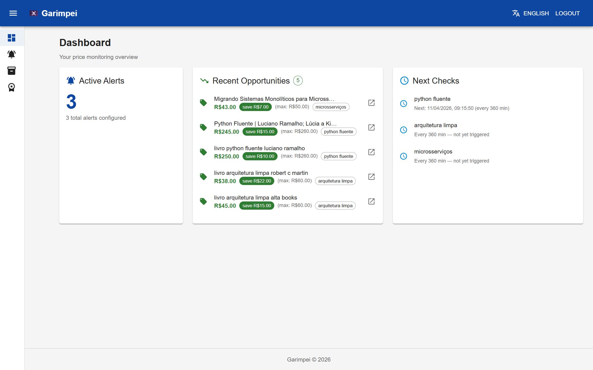
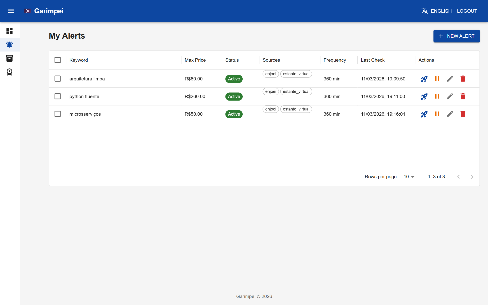
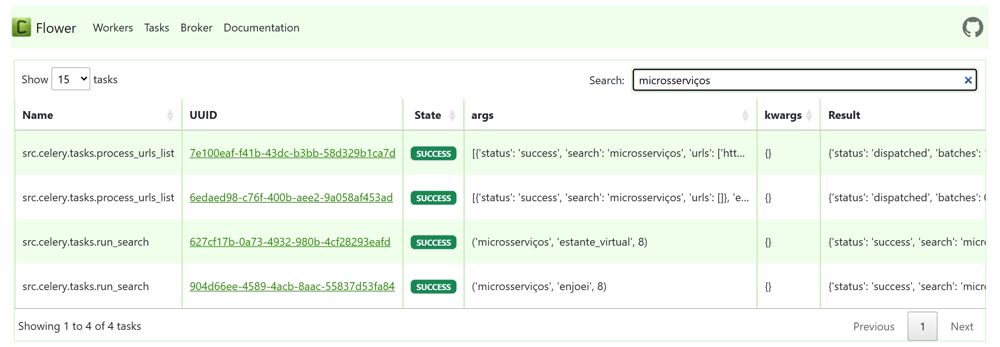
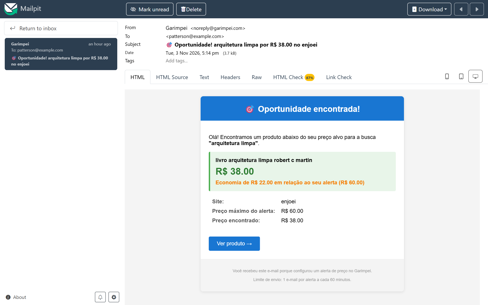
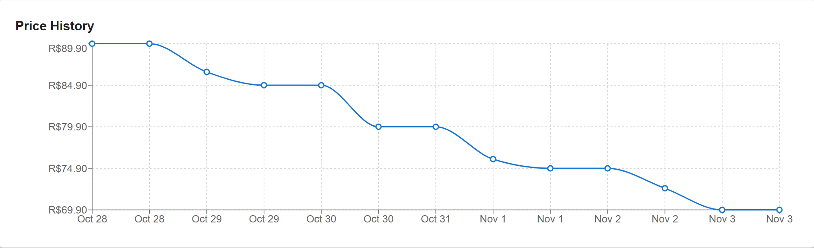
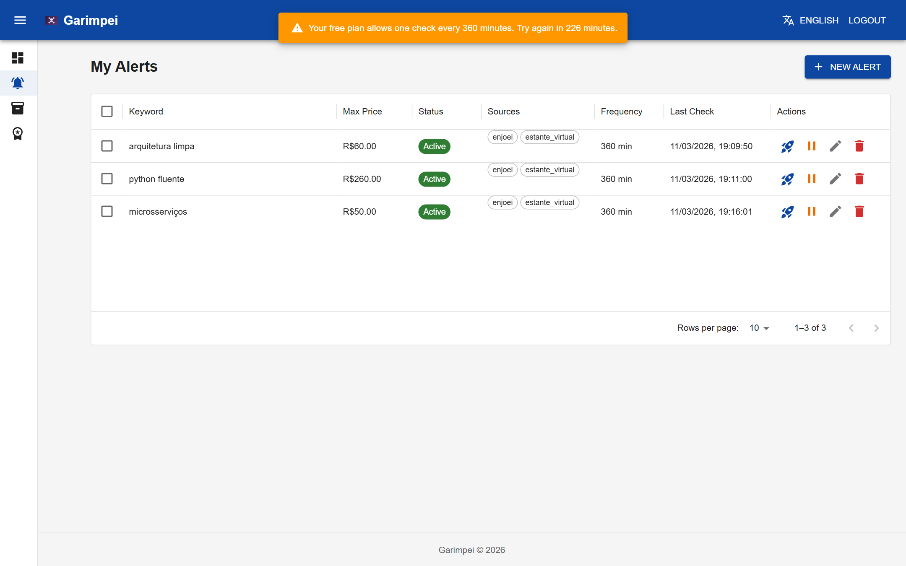
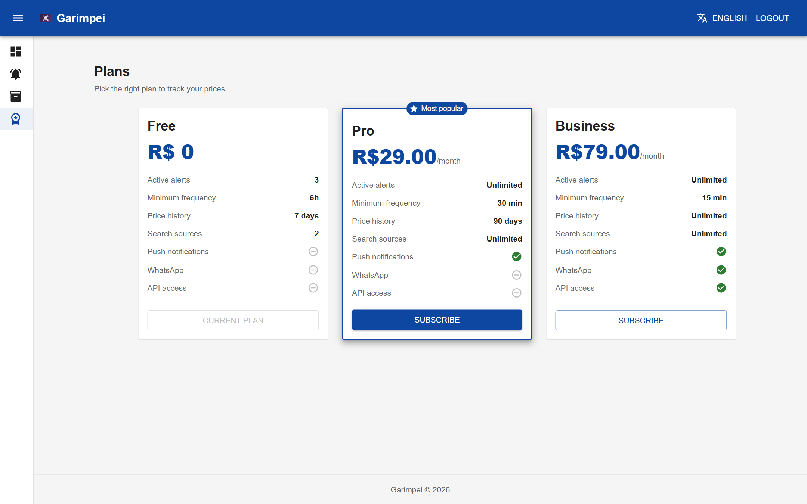
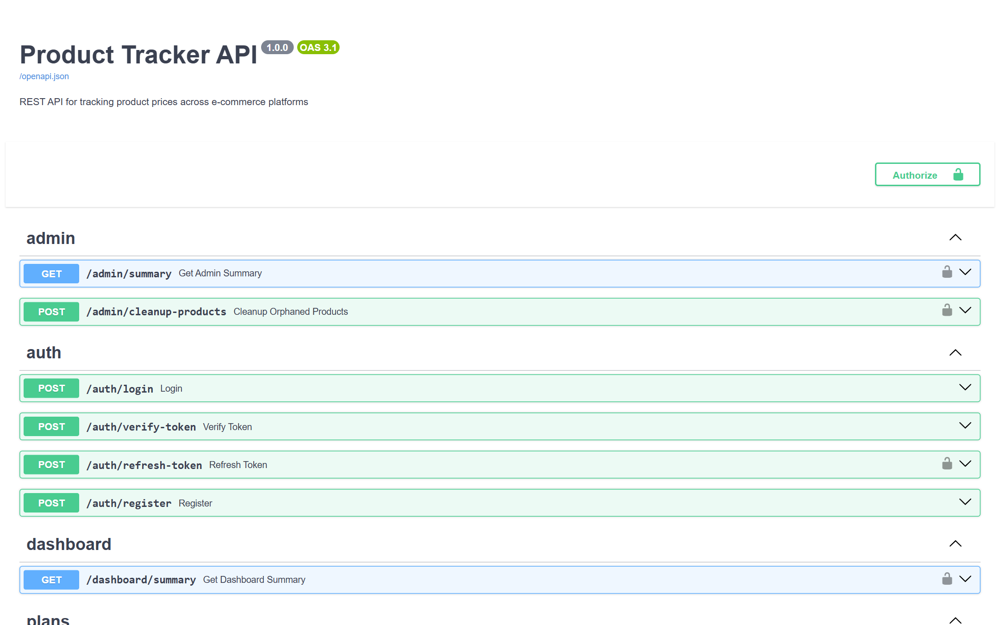
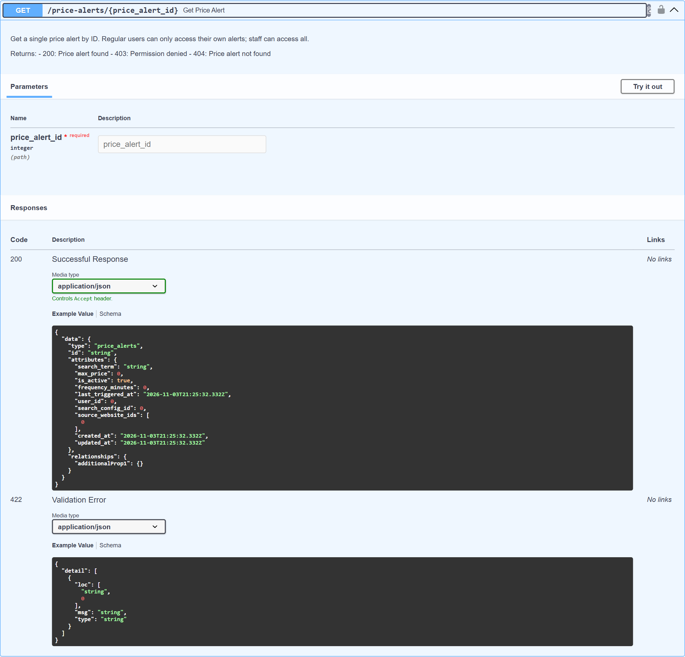
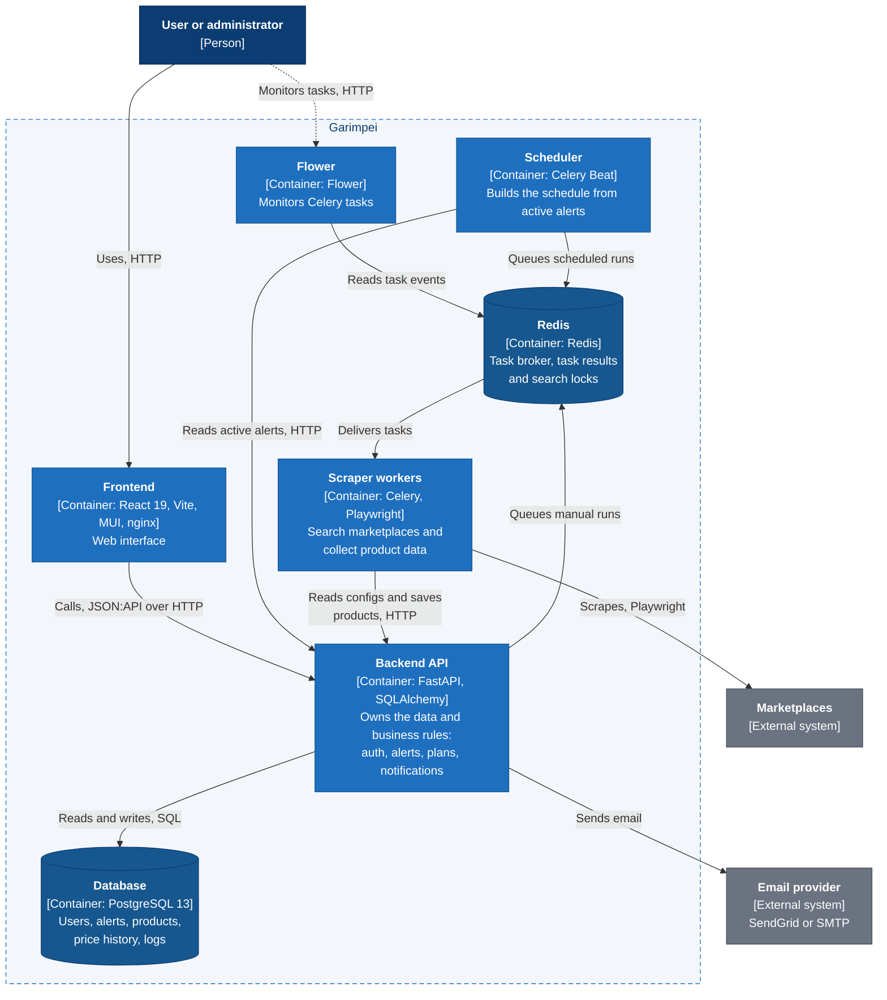

# 🏴‍☠️ Garimpei — Opportunity Hunter

> Development name: `product-tracker`

A price monitoring and opportunity detection system for Brazilian marketplaces.
It tracks product prices across OLX, Mercado Livre, Enjoei and Estante Virtual,
keeps the price history, sends email alerts when a product drops below a target
price, and provides a dashboard to manage alerts and spot opportunities.



| Service | Tech | Directory |
|---|---|---|
| **Backend** | FastAPI · SQLAlchemy · Alembic · PostgreSQL | [`backend/`](backend/README.md) |
| **Scrapers** | Celery · Playwright · BeautifulSoup · Redis | [`scrapers/`](scrapers/README.md) |
| **Frontend** | React 19 · Vite · MUI · TypeScript | [`frontend/`](frontend/README.md) |

---

## The problem

Good deals on second-hand and marketplace listings disappear fast, and checking
several sites by hand every day doesn't scale. I started Garimpei for my own
price research: I wanted one place that searches several marketplaces, remembers
past prices so I can see how they change over time, and warns me when something
shows up below the price I'm willing to pay.

It was designed so it could grow into a service, similar to existing price
aggregators, but today it is a personal project and has never been offered to the
public. Adding a new marketplace means writing one new scraper; the rest of the
system stays the same.

---

## Features

- 🔎 **Multi-marketplace scraping**: OLX, Mercado Livre, Enjoei, Estante Virtual
- 🎯 **Price alerts**: set a target price; get notified when a product shows up at or below it
- 📬 **Email notifications**: via SendGrid (or any SMTP server; Mailpit locally), with rate limiting and dedup
- ⏱️ **Scheduled and on-demand checks**: frequency per alert, plus a manual trigger
- 📊 **Dashboard**: manage alerts, follow price history, see opportunities
- 👤 **Admin dashboard**: user and system management
- 💳 **Freemium model**: plans, subscriptions and usage limits
- 🌐 **Bilingual UI**: Portuguese (default) and English, type-checked keys; a new language is one folder of JSON files ([how](frontend/src/i18n/README.md))
- 🧪 **Tested**: 900+ backend and scraper tests, frontend unit tests and Playwright E2E, CI on GitHub Actions

---

## How it works, in screenshots

**1. Set what you're hunting and the most you'll pay.** Each alert has a
keyword, a maximum price, the marketplaces to search and how often to check.



**2. Scrapers run in the background.** Celery Beat schedules each alert; one
search fans out into tasks per marketplace, then into batches of product pages.



**3. When a product shows up below your price, you get an email**, at most one
per alert per hour.



**4. Every check feeds the price history**, so you can see if a deal is really
a deal.



<sub>The chart above uses sample prices: real collection had only started when
it was taken.</sub>

**5. Plans set the limits, and the backend enforces them.** A Free user who
clicks *Run now* too soon gets the plan's rule back, not a silent failure.





**6. Every endpoint follows JSON:API**, documented with OpenAPI.





The UI is also in Portuguese (the default); screenshots in
[`docs/screenshots/`](docs/screenshots/).

---

## Architecture

C4 container view: the parts that run separately and how they talk. All four C4 levels (context, containers, backend and scraper components) are in [`docs/architecture`](docs/architecture/README.md).



**Alert flow:** the user creates a price alert. The search is queued on Redis
either by Celery Beat, on the alert's schedule, or by the backend itself when the
user clicks "Run Now". A scraper worker picks up the task, collects the listings
and sends them to the backend through its HTTP API; the backend compares each
price with the active alerts, emails the user when a price is at or below the
target, and the opportunity shows up on the dashboard.

### Design decisions

- **Scrapers talk to the backend only through its API, with no shared database.**
  The backend owns the data and the business rules (alerts, limits,
  notifications). Scrapers just collect and send. Letting the workers write
  straight to the database would be simpler at first, but it would tie every
  scraper to the schema and spread the rules across services. This way scrapers
  can be scaled, replaced or added without touching the data layer.
- **Clean architecture in the backend.** Entities and use cases don't depend on
  FastAPI, SQLAlchemy or SendGrid; those live at the edges (`infrastructure/`,
  `interfaces/`). Email, for example, goes through an interface with a SendGrid
  implementation, so changing the provider doesn't touch the alert logic.
- **Gentle scraping instead of fighting the anti-bot.** Mercado Livre blocks
  scrapers based on IP reputation. Investigating it showed the block is
  temporary and triggered by request frequency, not volume. So the scraper slows
  down: delays with jitter between pages, URL shuffling and a fresh browser
  context every few requests. It was validated on 492 products with zero blocks.
  Residential proxy support stays available as a fallback. Details in
  [`scrapers/MERCADO_LIVRE_NOTES.md`](scrapers/MERCADO_LIVRE_NOTES.md).
- **Notifications with rate limiting and dedup.** At most one email per alert
  per hour (configurable), and the same product doesn't trigger the same alert
  twice, so a busy search doesn't flood the user's inbox.
- **JSON:API for every endpoint**, so the frontend handles all resources the
  same way.

---

## What this project taught me

- Clean architecture in practice, while reading Uncle Bob's book: architectural
  boundaries, pure entities, and seeing that SOLID applies to how services
  relate to each other, not only to classes.
- FastAPI from scratch. I had used Django and Flask before; this was the first
  project I started from zero with FastAPI.
- The front end, with React, Vite and TypeScript. I'm a backend engineer, but I
  wanted to build the whole thing myself.

---

## Next steps

- [ ] Move it to AWS, using the project to practice AWS services
- [ ] Load testing: many users and many scrapers running at the same time
- [ ] Run Celery workers on separate machines
- [ ] Social login (Google)
- [ ] More notification channels and a better front end
- [ ] More scrapers (Shopee, Amazon BR)

Full roadmap in [`ROADMAP.md`](ROADMAP.md).

---

## Quick start

```bash
# Clone
git clone https://github.com/pattersonrptr/garimpei.git
cd garimpei

# Copy env file and adjust as needed
cp .env.example .env

# Start everything
make up

# Or without Make:
docker compose up --build
```

The services will be available at:

| Service | URL |
|---|---|
| Backend API | http://localhost:8000 |
| Frontend | http://localhost |
| Flower (Celery monitor) | http://localhost:5555 |
| Mailpit (local email inbox) | http://localhost:8026 |
| API Docs (Swagger) | http://localhost:8000/docs |

---

## Development

```bash
# Run only infrastructure (db + redis)
make infra

# Backend dev server (outside Docker)
make backend-dev

# Frontend dev server (outside Docker)
make frontend-dev

# Run all tests
make test

# Run tests for a specific service
make backend-test
make scrapers-test
make frontend-test

# Lint
make lint
```

See the [`Makefile`](Makefile) for all available commands.

---

## Project structure

```
garimpei/
├── backend/          ← FastAPI application + database
├── scrapers/         ← Celery workers + web scraping engines
├── frontend/         ← React SPA
├── docker-compose.yml
├── Makefile
├── .github/workflows/ci.yml
└── ROADMAP.md        ← Product roadmap
```

---

## Status and usage

Active personal project, still evolving (already functional). Built for personal
use and as a portfolio project. Scraping targets public marketplace listings;
respect each platform's Terms of Service before any non-personal use.

---

## License

[GNU Affero General Public License v3.0](LICENSE) (AGPL-3.0-only).

You may use, study, modify and share this code, but if you run a modified version as a
network service, you must make its complete source code available under the same license.
For commercial licensing under different terms, contact the author.
