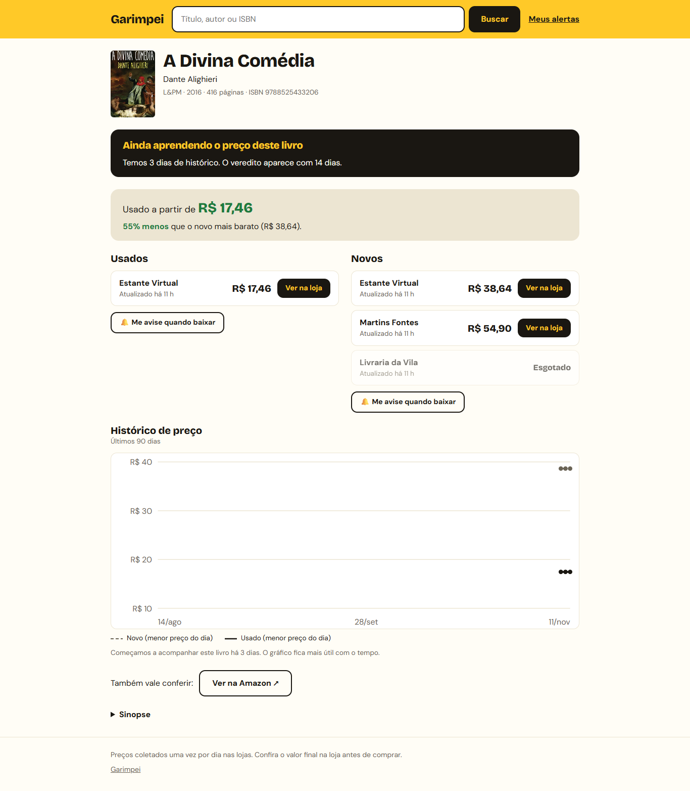
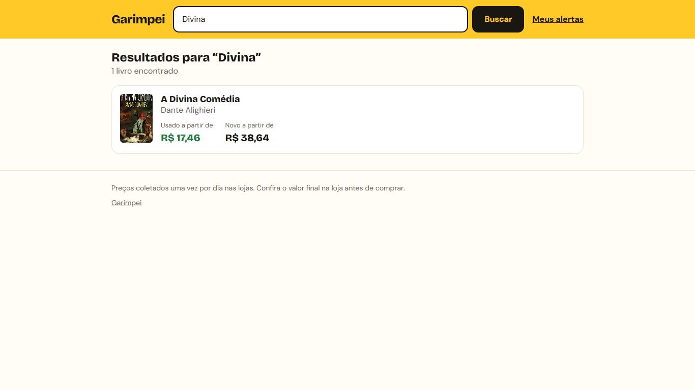
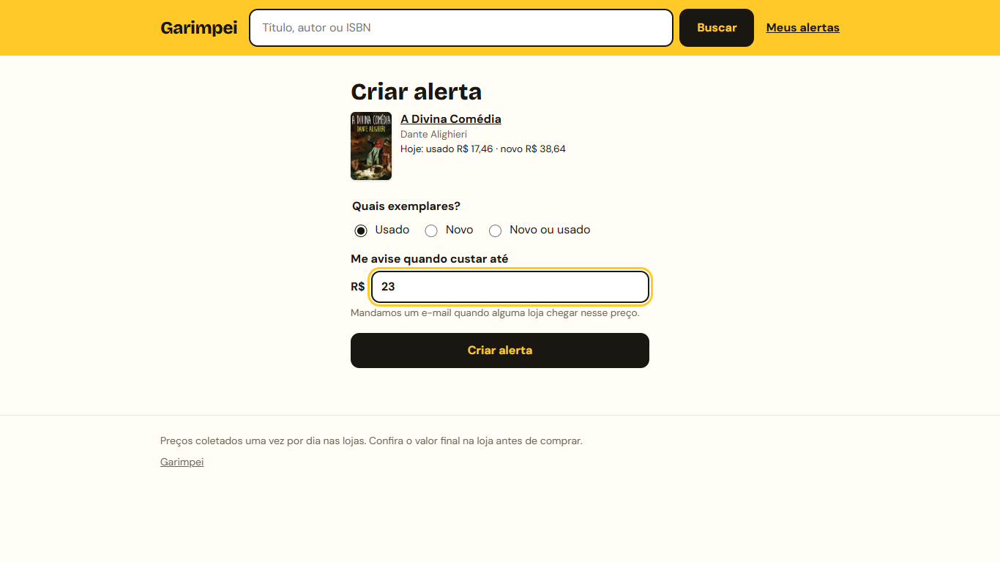
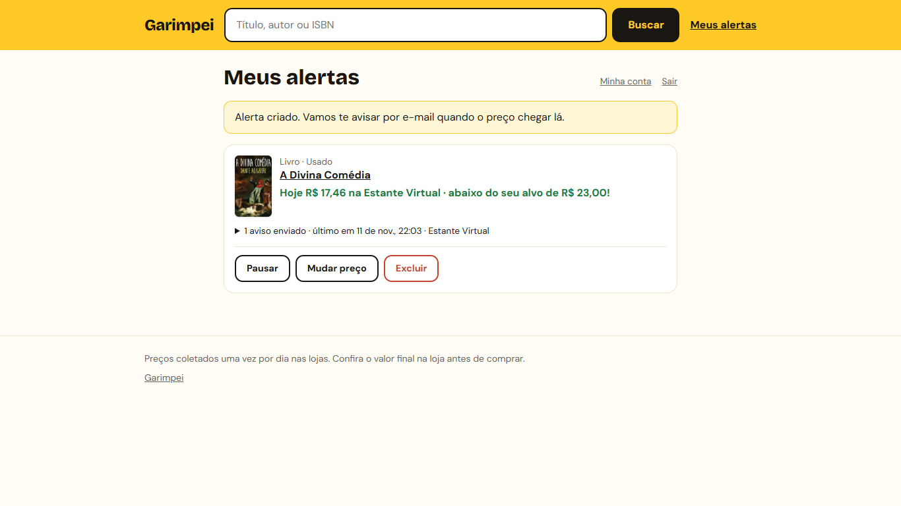
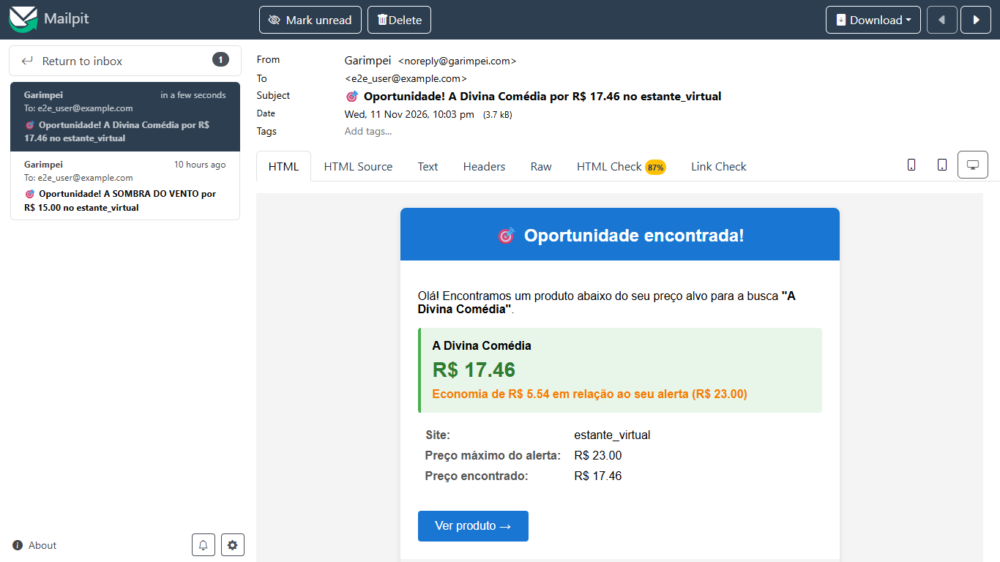
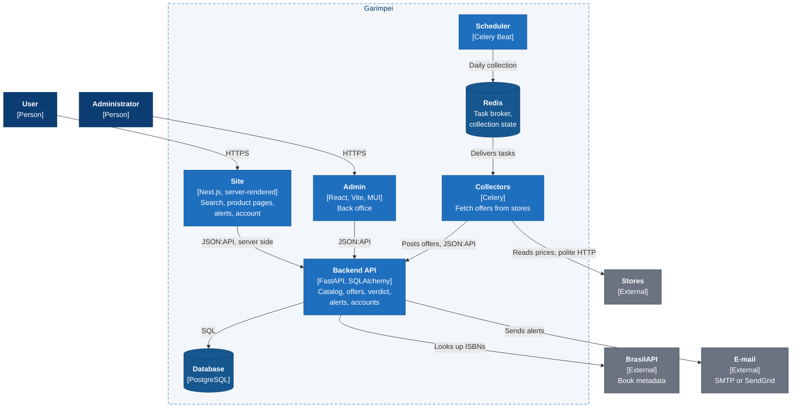

# Garimpei

> 🇧🇷 [Leia em português](README.pt-BR.md)

A price comparator for Brazil. When I want to buy something, especially a book,
I have to open several stores, compare new and used, and guess whether today's
price is good. Garimpei puts new and used offers side by side, keeps the price
history, says whether the price is good right now, and e-mails me when it
reaches the value I want. Books come first because the ISBN makes it easy to
know two listings are the same product; the model is generic, so other
categories fit later. Every change goes through tests, CI and an end-to-end run
in the browser before I approve the merge. Next: the admin on the new site, and
moving to AWS.

**[How I work with AI on this project →](docs/working-with-ai.en.md)**



<sub>Real data collected locally. The price verdict (good, normal, expensive right now) shows up
after 14 days of history; this book had 3. [Mobile version](docs/screenshots/site-book-page-mobile.png).</sub>

---

## What it does

- **Search** by title, author or ISBN, with no sign-in.
- **Product page:** new and used offers side by side, how much less the used
  copy costs, when each price was checked, and a 90-day price chart.
- **Price verdict:** good price, normal price or expensive right now, comparing
  today's lowest price with the last 90 days.
- **Alerts:** "Me avise quando baixar" (warn me when it drops) creates an alert
  on the product; an e-mail arrives when an offer reaches the target.
- **User area:** sign up, sign in, "Meus alertas" (my alerts: pause, change
  the price, delete, see what was sent) and the account page.
- **Daily collection:** Estante Virtual (new and used), Livraria da Vila and
  Martins Fontes, collected politely once a day. Amazon only through an
  affiliate link, never scraped.
- **Admin back office** for stores, users and collection runs.

### The journey in screenshots

Search, compare, ask to be warned, get the e-mail. A short silent video of the
same journey is in [`docs/demo/garimpei-demo.webm`](docs/demo/garimpei-demo.webm).

| Search | Create an alert |
|---|---|
|  |  |
| **My alerts** | **The e-mail** (local inbox) |
|  |  |

<sub>The e-mail still has the old app's look; it will get Garimpei's identity.
Mobile versions are in [`docs/screenshots/`](docs/screenshots/). All of this is
generated by a Playwright script, so it can be taken again when the screens
change: see [`frontend/e2e/media/`](frontend/e2e/media/tour.media.ts).</sub>

## Architecture



**The main flow:** once a day the scheduler queues a collection per store. A
collector fetches each book's offers and posts them to the API; the API
matches them to the book by ISBN, adds a point to the price history and
checks the alerts on that book. The site renders the pages on the server,
reading the same API.

**Key decisions** (the reasons are in the [AI workflow doc](docs/working-with-ai.en.md#5-some-decisions-explained)
and in the [plan](docs/plan/README.md)):

- Collectors never touch the database: they send plain offers to the API,
  which owns the data and the rules.
- Clean Architecture, organized by domain (`catalog`, `alerts`, …): pure
  entities, ports owned by the module that needs them.
- Only collect from stores that allow it; plain HTTP first, a browser only
  when the page needs JavaScript, long pauses, stop at the first block.
- Public pages in Next.js, rendered on the server for SEO and speed; the
  session lives in an `httpOnly` cookie.
- Refactor in small steps, one module per PR, never all at once.

## Quick start

Requires Docker with Compose.

```bash
git clone https://github.com/pattersonrptr/garimpei.git
cd garimpei
cp .env.example .env
docker compose up -d --build
```

The backend runs the migrations and loads development data on start. To fill
the catalog with the seed books (metadata from BrasilAPI):

```bash
docker compose exec web python -m src.scripts.load_seed_books
```

| Service | URL |
|---|---|
| Site | http://localhost:3000 |
| Admin | http://localhost |
| API and Swagger docs | http://localhost:8000 · http://localhost:8000/docs |
| Mailpit (local inbox) | http://localhost:8026 |
| Flower (Celery monitor) | http://localhost:5555 |

If port 5432 is already taken by a local PostgreSQL, copy
`docker-compose.override.example.yml` to `docker-compose.override.yml` (not
committed): it publishes the database on 5434.

## Development

Each folder has its own checks; they are the same ones CI runs.

| Folder | Commands |
|---|---|
| `backend/` | `pytest src/tests` · `ruff check src` · `ruff format --check src` |
| `scrapers/` | `poetry run pytest src/tests` · `poetry run ruff check src` |
| `web/` | `npm test` · `npm run typecheck` · `npm run build` |
| `frontend/` | `npm run lint` · `npm test` · `npx tsc -b` |

End-to-end tests (Playwright) run from `frontend/` against the local stack.
The [`Makefile`](Makefile) has shortcuts for the older commands.

## Project structure

```
garimpei/
├── backend/     FastAPI API, domain modules under src/app/<module>/
├── scrapers/    Celery collectors that post offers to the API
├── web/         Public site (Next.js): everything a user does
├── frontend/    Admin back office (Vite + React + MUI) and the E2E tests
├── docs/
│   ├── plan/          The plan and one file per phase, with decisions
│   ├── architecture/  Architecture decisions
│   └── working-with-ai.en.md
├── AGENTS.md    Working agreement for AI coding agents
└── docker-compose.yml
```

## What this project taught me

- **Clean Architecture in practice.** I read Uncle Bob's book while writing
  the first version, and the repositories, use cases and presenters were there
  before any AI. Now the code is moving to modules named after the domain, and
  I see that the rules apply between modules and services, not only to classes.
- **FastAPI from scratch.** I had used Django and Flask; this was the first
  project I started from zero with FastAPI.
- **Building the whole thing.** I am a backend engineer, but I wanted to do the
  front end too: first React with Vite, now Next.js with server rendering.
- **Working with AI without losing control.** I decide the product and the
  architecture; the AI proposes and implements, and tests, CI, hooks and my
  review catch its mistakes. That is in its own [document](docs/working-with-ai.en.md).

## Next steps

The full plan is in [`docs/plan/README.md`](docs/plan/README.md).

- [ ] Run the E2E tests in CI
- [ ] Move the admin to Next.js and retire the Vite app
- [ ] Password reset and a welcome e-mail
- [ ] Move to AWS, within a cost limit
- [ ] More stores, through affiliate feeds and APIs where they exist

## Status

A personal project, working locally, with no production deployment and no
commercial launch planned yet. Collection targets public store pages, slowly
and only where the terms allow it.

## License

[GNU Affero General Public License v3.0](LICENSE) (AGPL-3.0-only).

You may use, study, modify and share this code, but if you run a modified
version as a network service, you must make its complete source code available
under the same license. For commercial licensing under different terms, contact
the author.
