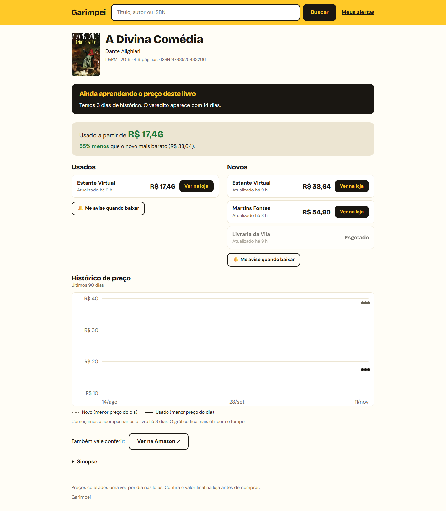
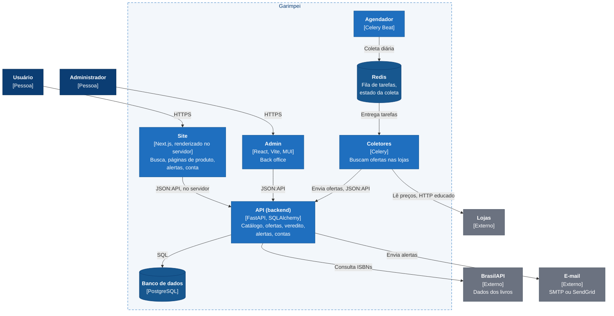

# Garimpei

> 🇺🇸 [Read in English](README.md)

Um comparador de preços para o Brasil. Quando quero comprar algo,
principalmente um livro, preciso abrir várias lojas, comparar novo e usado e
adivinhar se o preço de hoje está bom. O Garimpei coloca ofertas novas e usadas
lado a lado, guarda o histórico de preços, diz se o preço está bom agora e me
manda um e-mail quando ele chega no valor que eu quero. Livros vêm primeiro
porque o ISBN facilita saber que dois anúncios são o mesmo produto; o modelo é
genérico, então outras categorias cabem depois. Toda mudança passa por testes,
CI e um teste ponta a ponta no navegador antes de eu aprovar o merge. Próximos
passos: o admin no site novo e a mudança para a AWS.

**[Como eu trabalho com IA neste projeto →](docs/working-with-ai.md)**



<sub>Dados reais coletados localmente. O veredito ("Bom preço", "Caro agora"…)
aparece com 14 dias de histórico; este livro tinha 3. [Versão celular](docs/screenshots/site-book-page-mobile.png).</sub>

---

## O que ele faz

- **Busca** por título, autor ou ISBN, sem precisar entrar.
- **Página do produto:** ofertas novas e usadas lado a lado, quanto o usado
  custa a menos, quando cada preço foi checado e um gráfico de 90 dias.
- **Veredito de preço:** "Bom preço", "Preço normal" ou "Caro agora", comparando o
  menor preço de hoje com os últimos 90 dias.
- **Alertas:** "Me avise quando baixar" cria um alerta no produto; chega um
  e-mail quando uma oferta atinge o valor desejado.
- **Área do usuário:** cadastro, login, "Meus alertas" (pausar, mudar o preço,
  excluir, ver o que foi enviado) e a página da conta.
- **Coleta diária:** Estante Virtual (novo e usado), Livraria da Vila e Martins
  Fontes, coletadas com educação uma vez por dia. Amazon só por link de
  afiliado, nunca por scraping.
- **Admin (back office)** para lojas, usuários e execuções da coleta.

## Arquitetura



**O fluxo principal:** uma vez por dia o agendador enfileira uma coleta por
loja. Um coletor busca as ofertas de cada livro e as envia para a API; a API
liga cada oferta ao livro pelo ISBN, acrescenta um ponto no histórico de preço
e confere os alertas daquele livro. O site monta as páginas no servidor, lendo
a mesma API.

**Decisões principais** (os motivos estão no [documento sobre IA](docs/working-with-ai.md#5-algumas-decisões-explicadas)
e no [plano](docs/plan/README.md)):

- Coletores nunca tocam no banco: mandam ofertas simples para a API, que é
  dona dos dados e das regras.
- Clean Architecture, organizada por domínio (`catalog`, `alerts`, …):
  entidades puras, interfaces (ports) definidas pelo módulo que precisa delas.
- Só coletar de lojas que permitem; HTTP simples primeiro, navegador só quando
  a página depende de JavaScript, pausas longas, parar no primeiro bloqueio.
- Páginas públicas em Next.js, renderizadas no servidor por SEO e velocidade;
  a sessão fica num cookie `httpOnly`.
- Refatorar em passos pequenos, um módulo por PR, nunca tudo de uma vez.

## Como rodar

Precisa de Docker com Compose.

```bash
git clone https://github.com/pattersonrptr/garimpei.git
cd garimpei
cp .env.example .env
docker compose up -d --build
```

O backend roda as migrations e carrega os dados de desenvolvimento ao subir.
Para preencher o catálogo com os livros iniciais (dados da BrasilAPI):

```bash
docker compose exec web python -m src.scripts.load_seed_books
```

| Serviço | URL |
|---|---|
| Site | http://localhost:3000 |
| Admin | http://localhost |
| API e documentação Swagger | http://localhost:8000 · http://localhost:8000/docs |
| Mailpit (caixa de e-mail local) | http://localhost:8026 |
| Flower (monitor do Celery) | http://localhost:5555 |

Se a porta 5432 já estiver ocupada por um PostgreSQL local, copie
`docker-compose.override.example.yml` para `docker-compose.override.yml` (fora
do git): ele publica o banco na 5434.

## Desenvolvimento

Cada pasta tem suas próprias verificações; são as mesmas que o CI roda.

| Pasta | Comandos |
|---|---|
| `backend/` | `pytest src/tests` · `ruff check src` · `ruff format --check src` |
| `scrapers/` | `poetry run pytest src/tests` · `poetry run ruff check src` |
| `web/` | `npm test` · `npm run typecheck` · `npm run build` |
| `frontend/` | `npm run lint` · `npm test` · `npx tsc -b` |

Os testes ponta a ponta (Playwright) rodam a partir de `frontend/`, contra o
ambiente local. O [`Makefile`](Makefile) tem atalhos para os comandos mais
antigos.

## Estrutura

```
garimpei/
├── backend/     API FastAPI, módulos de domínio em src/app/<módulo>/
├── scrapers/    Coletores Celery que enviam ofertas para a API
├── web/         Site público (Next.js): tudo o que o usuário faz
├── frontend/    Admin (Vite + React + MUI) e os testes E2E
├── docs/
│   ├── plan/          O plano e um arquivo por fase, com as decisões
│   ├── architecture/  Decisões de arquitetura
│   └── working-with-ai.md
├── AGENTS.md    Acordo de trabalho para agentes de IA
└── docker-compose.yml
```

## O que este projeto me ensinou

- **Clean Architecture na prática.** Li o livro do Uncle Bob enquanto escrevia
  a primeira versão, e os repositórios, casos de uso e presenters já estavam lá
  antes de qualquer IA. Agora o código está indo para módulos com nome de
  domínio, e eu vejo que as regras valem entre módulos e serviços, não só
  entre classes.
- **FastAPI do zero.** Eu já tinha usado Django e Flask; este foi o primeiro
  projeto que comecei do zero com FastAPI.
- **Construir tudo.** Sou engenheiro de backend, mas quis fazer o front end
  também: primeiro React com Vite, agora Next.js com renderização no servidor.
- **Trabalhar com IA sem perder o controle.** Eu decido o produto e a
  arquitetura; a IA propõe e implementa, e testes, CI, hooks e a minha revisão
  pegam os erros dela. Isso tem um [documento próprio](docs/working-with-ai.md).

## Próximos passos

O plano completo está em [`docs/plan/README.md`](docs/plan/README.md).

- [ ] Rodar os testes E2E no CI
- [ ] Levar o admin para o Next.js e aposentar o app Vite
- [ ] Recuperação de senha e e-mail de boas-vindas
- [ ] Mudar para a AWS, dentro de um limite de custo
- [ ] Mais lojas, por feeds e APIs de afiliados onde existirem

## Status

Projeto pessoal, funcionando localmente, sem deploy em produção e sem
lançamento comercial planejado por enquanto. A coleta usa páginas públicas das
lojas, devagar e só onde os termos permitem.

## Licença

[GNU Affero General Public License v3.0](LICENSE) (AGPL-3.0-only).

Você pode usar, estudar, modificar e compartilhar este código, mas, se rodar
uma versão modificada como serviço em rede, precisa disponibilizar o código
completo sob a mesma licença. Para licenciamento comercial em outros termos,
fale com o autor.
