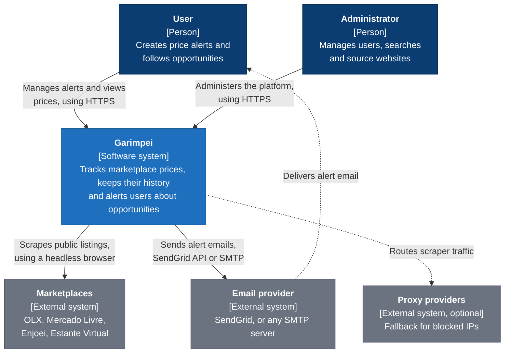
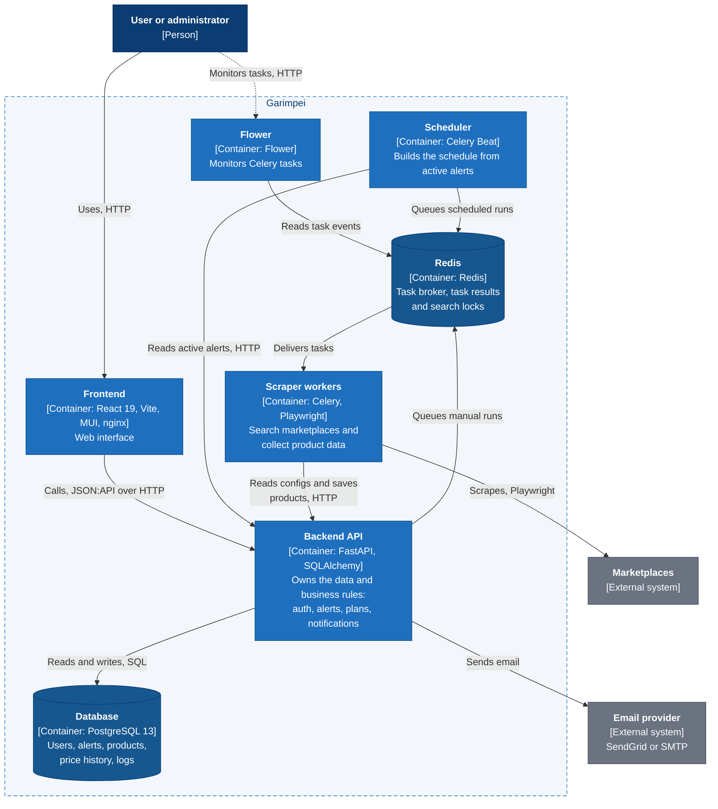
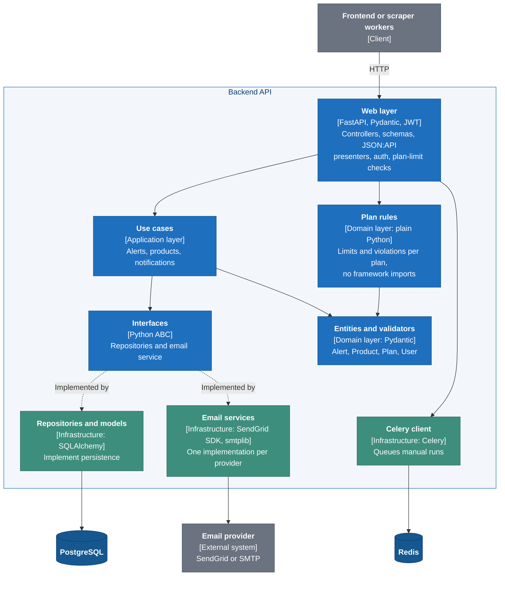

# Garimpei architecture

C4 model diagrams for Garimpei. They are written in Mermaid, so GitHub renders them
directly and every change shows up as a normal text diff.

PNG versions (for places that don't render Mermaid) are in [`images/`](images/).
To regenerate them after editing this file, run from the repository root:

```bash
npx -y @mermaid-js/mermaid-cli -i docs/architecture/README.md -o docs/architecture/images/c4.png -s 3 -b white
```

## Level 1: System context

Who uses Garimpei and which external systems it depends on.



## Level 2: Containers

The separately running parts of the system. Scrapers have no database access: everything
they read or store goes through the API.



## Level 3: Backend API components

Clean Architecture layers inside the API. Dependencies point inward: the web layer
and the infrastructure depend on use cases and domain, never the other way around.
Persistence and email sit behind interfaces, so adding the SMTP backend next to
SendGrid did not touch any use case.



## Level 3: Scraper components

How the Celery workers turn one search into saved products.

```mermaid
flowchart LR
    beat["<b>Celery Beat</b><br/>[Scheduler]"]
    api["<b>Backend API</b><br/>[FastAPI]"]
    redis[("<b>Redis</b><br/>Task queue<br/>and search lock")]

    subgraph workers["Scraper workers"]
        direction TB
        runsearch["<b>run_scraper_search</b><br/>[Celery task]<br/>Takes the lock, starts<br/>one search per site"]
        search["<b>run_search</b><br/>[Celery task]<br/>Collects product URLs"]
        process["<b>process_urls_list</b><br/>[Celery task]<br/>Splits URLs into batches of 20"]
        batch["<b>scrape_batch</b><br/>[Celery task]<br/>Scrapes a batch with one browser"]
        save["<b>save_products</b><br/>[Celery task]<br/>Saves data, triggers alert evaluation"]
        runsearch --> search --> process --> batch --> save
    end

    subgraph engine["Scraping engine and API access"]
        direction TB
        manager["<b>ScraperManager and ScraperFactory</b><br/>[Python]<br/>Create and run the right scraper"]
        scrapers["<b>Site scrapers</b><br/>[Playwright]<br/>OLX, Mercado Livre,<br/>Enjoei, Estante Virtual"]
        proxy["<b>Proxy rotators</b><br/>[Python, optional]<br/>Paid or free proxies"]
        client["<b>ApiClient</b><br/>[requests]<br/>Authenticated API calls"]
        manager --> scrapers
        scrapers -.-> proxy
    end

    markets["<b>Marketplaces</b><br/>[External system]"]
    apiOut["<b>Backend API</b><br/>[FastAPI]"]

    beat -->|"Queues search"| redis
    api -->|"Queues manual search"| redis
    redis -->|"Delivers task"| runsearch
    batch -->|"run_search and scrape_batch<br/>use the scrapers"| manager
    save -->|"run_scraper_search and<br/>save_products call the API"| client
    scrapers -->|"Site scrapers open a<br/>headless browser"| markets
    client -->|"ApiClient sends<br/>JSON:API over HTTP"| apiOut

    classDef component fill:#1F6FBF,stroke:#17578F,color:#fff
    classDef store fill:#17578F,stroke:#0B3D73,color:#fff
    classDef external fill:#6B7280,stroke:#4B5563,color:#fff
    class runsearch,search,process,batch,save,manager,scrapers,proxy,client component
    class redis store
    class beat,api,apiOut,markets external
    style workers fill:#F3F7FB,stroke:#1F6FBF,color:#0B3D73
    style engine fill:#F3F7FB,stroke:#1F6FBF,color:#0B3D73
```


